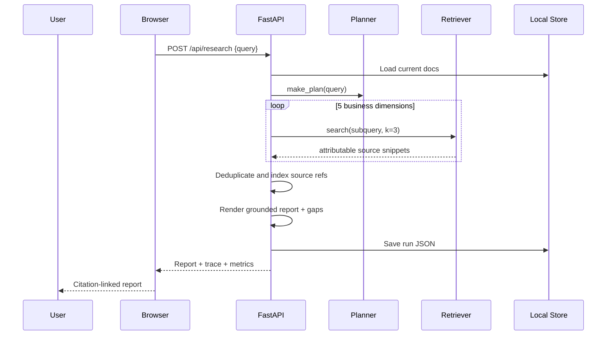

# Technical architecture / implementation notes

## System boundary

- Browser SPA served by FastAPI as static HTML/CSS/JS; no external CDN dependency.
- API server stores documents and historical run results as JSON files in `workspace/`.
- Each request rebuilds a TF-IDF index on the current corpus. For MVP max 40 documents, 8MB per upload, 120k extracted characters per document.
- `LocalRetriever` chunks on paragraph boundaries and further splits long paragraphs with overlap; char n-grams `2–4`, cosine similarity ranking.
- `build_research` plans five steps, deduplicates by source chunk, creates `[S1]..[Sn]` citations, and builds source index, gap warnings and trace information.
- Optional remote LLM receives limited retrieved excerpts; NEVER API credentials in logs or frontend. Offline mode never calls remote services.
- No external data acquisition, web scraping, autonomous browser agent, direct database connectors, or production permissions.

## Sequence



## Safety boundaries

- File extension allowlist and byte limits; text-only PDF extraction (no OCR).
- Pydantic query bounds, bounded citation counts, bounded model output, verified citation IDs.
- Remote generation explicitly opt-in; LLM is instructed to treat source content as untrusted data, and potentially unreliable synthesis is labeled.
- Frontend escapes source-derived HTML before displaying content (prevents stored XSS in reports).
- Server is single-user local demo and **not** hardened for internet exposure. No authentication, no multi-tenant separation, no file scanning.

## Repo files

```
research_agent/api.py        FastAPI endpoints
research_agent/engine.py     Agent orchestration, evidence registry, optional LLM
research_agent/retrieval.py  Chunking + search
research_agent/planner.py    Five research steps
research_agent/ingest.py     Format-safe extraction
research_agent/evaluation.py Retrieval evaluation
research_agent/store.py      Local persistence
research_agent/tools.py      Numeric tools
research_agent/demo.py       Synthetic data bootstrap
web/                         Web application
examples/                    Fictional company data and labeled tasks
tests/                       Reproducible pytest suite
```
